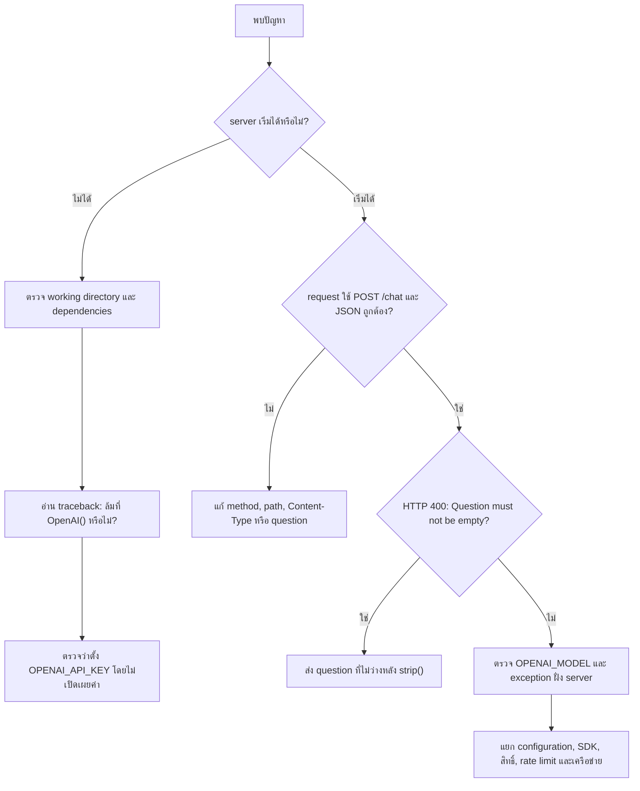

# Troubleshooting: API ถามตอบ

คู่มือแยกสาเหตุและแก้ปัญหาของ [api.py](../api.py) ตั้งแต่เริ่ม server จนถึงการเรียก OpenAI ดูการติดตั้งและตัวอย่าง Request/Response ใน [คู่มือ API](api.md) หรือกลับไปที่ [README](../README.md)

**สถานะ:** ตรวจจากโค้ดเท่านั้น ไม่มี Log หรือผลรันจริง ยังไม่ได้รันคำสั่งในคู่มือนี้ เวอร์ชัน dependencies และการ render Mermaid ยังไม่ยืนยัน ทุกปัญหาด้านล่างเป็น **ตัวอย่างอาการที่อาจพบ** ไม่ใช่เหตุการณ์ที่ยืนยันว่าเคยเกิดขึ้น ข้อความ `Question must not be empty` มีอยู่จริงในโค้ด แต่ไม่มีหลักฐานว่าเคยถูกส่งกลับจริง

## แผนภาพการแยกสาเหตุ

ภาพที่ 1 แสดงลำดับตรวจปัญหา ไม่ใช่ flow การจัดการ error ที่แอปทำให้อัตโนมัติ:



จุดตรวจอ้างอิง [api.py](../api.py): `OpenAI()` ทำงานตอน import, `ChatRequest` ตรวจ schema, `chat()` ตรวจคำถามว่าง แล้วจึงอ่าน `OPENAI_MODEL` และเรียก `responses.create()` หากมีปัญหาอื่นนอกเส้นทางนี้ ต้องใช้ traceback เพิ่มเติม ไม่สรุปจาก HTTP status อย่างเดียว

## ตรวจเบื้องต้น

ใช้ PowerShell จากโฟลเดอร์ที่มี `api.py` คำสั่งเหล่านี้ตรวจไฟล์ แพ็กเกจ และการมีอยู่ของ environment variables ไม่เปิด server และไม่เรียกโมเดล:

```powershell
Get-Location
Test-Path -LiteralPath '.\api.py'
Test-Path -LiteralPath '.\.venv\Scripts\python.exe'
[bool]$env:OPENAI_API_KEY
[bool]$env:OPENAI_MODEL
```

หาก Python ใน `.venv` มีอยู่ จึงตรวจแพ็กเกจ:

```powershell
.\.venv\Scripts\python.exe -m pip show fastapi pydantic openai uvicorn
```

ผล `True` ของ environment variable ยืนยันเพียงว่ามีค่า ไม่ได้ยืนยันว่า key ถูกต้องหรือบัญชีเข้าถึงโมเดลได้ อย่าแสดงค่าจริงของ key ใน screenshot, Log หรือรายงานปัญหา

## 1. เริ่ม server ไม่ได้หรือ import แพ็กเกจไม่สำเร็จ

**ที่มา:** imports และตัวแปร `app` ใน [api.py](../api.py) ไม่ได้มี error log จริงให้ตรวจ

- **สาเหตุที่เป็นไปได้:** working directory ไม่ถูกต้อง ไม่มีแพ็กเกจใน interpreter ที่ใช้ หรือใช้ชื่อโมดูลผิด
- **วิธีตรวจ:** ตรวจว่ามี `api.py` ในโฟลเดอร์ปัจจุบัน ตรวจแพ็กเกจตามคำสั่งด้านบน แล้วอ่าน traceback เพื่อแยกปัญหา module lookup ออกจาก exception ขณะสร้าง client
- **วิธีแก้:** รันจากโฟลเดอร์ที่ถูกต้อง ใช้ Python environment เดียวกับที่ติดตั้งแพ็กเกจ และใช้ `api:app` หากขาดแพ็กเกจให้ติดตั้งตาม [วิธีเตรียมระบบ](api.md#setup) หากล้มที่ `OpenAI()` ให้ตรวจหัวข้อถัดไป
- **วิธียืนยันภายหลัง:** เปิด server ตามคู่มือแล้วตรวจว่าโหลดแอปสำเร็จ การรัน `python api.py` อย่างเดียวไม่เปิด HTTP server

## 2. แอปโหลดไม่ได้ที่ `OpenAI()`

**ที่มา:** `client = OpenAI()` อยู่ระดับโมดูลใน [api.py](../api.py)

- **สาเหตุที่เป็นไปได้:** `OPENAI_API_KEY` ไม่อยู่ใน environment ของ process ที่เปิด server
- **วิธีตรวจ:** ดูตำแหน่งใน traceback และใช้ `[bool]$env:OPENAI_API_KEY` ใน shell เดียวกับที่จะเริ่ม server โดยไม่พิมพ์ค่า key
- **วิธีแก้:** ตั้ง key ผ่าน environment อย่างปลอดภัยก่อนเริ่ม server ใหม่ โค้ดไม่ได้โหลด `.env` เอง จึงไม่เพียงพอที่จะสร้าง `.env` อย่างเดียว
- **วิธียืนยันภายหลัง:** แอปโหลดผ่านจุดสร้าง client ได้ การเริ่มแอปได้ยังไม่ยืนยันว่า key ใช้เรียกบริการได้จริง

## 3. HTTP 400 พร้อม `Question must not be empty`

**ที่มา:** ข้อความและ status code ระบุโดยตรงใน `chat()` ของ [api.py](../api.py)

- **สาเหตุ:** `question` ว่างหลัง `request.question.strip()` รวมถึงข้อความที่เป็น whitespace ล้วน
- **วิธีตรวจ:** ตรวจ request body ว่าส่ง `question` เป็น string ที่มีเนื้อหาหรือไม่
- **วิธีแก้:** ส่งข้อความที่ไม่ว่าง เช่น request สมมุติ `{"question":"สวัสดี"}`
- **วิธียืนยันภายหลัง:** คำถามว่างควรได้ HTTP 400 ส่วนคำถามที่มีเนื้อหาควรผ่านจุดนี้ ทั้งนี้คำถามที่มีเนื้อหาจะเข้าสู่การเรียกบริการภายนอกและอาจมีค่าใช้จ่าย

ตัวอย่าง body ที่คาดตามโค้ดและรูปแบบ HTTPException ของ FastAPI ไม่ใช่ผลรันจริง:

```json
{"detail":"Question must not be empty"}
```

## 4. Request ไม่ผ่าน schema หรือใช้ method ผิด

**ที่มา:** `ChatRequest` มี `question: str` และ decorator ลงทะเบียนเฉพาะ `POST /chat` ใน [api.py](../api.py)

- **ตัวอย่างอาการที่อาจพบ:** HTTP 422 ตาม validation ของ FastAPI หรือเรียก `/chat` ด้วย `GET` แล้วใช้งานไม่ได้ตามต้องการ
- **สาเหตุที่เป็นไปได้:** ไม่มี field `question`, JSON ผิดรูปแบบ, ค่าไม่ผ่าน schema หรือเปิด URL ผ่าน browser ซึ่งส่ง `GET`
- **วิธีตรวจ:** ตรวจ method, path, `Content-Type` และ body เทียบ [ตัวอย่าง Request](api.md#examples) อ่านรายละเอียด validation response; รูปแบบข้อความขึ้นกับเวอร์ชัน framework
- **วิธีแก้:** ส่ง `POST /chat` พร้อม `Content-Type: application/json` และ JSON ที่มี `question` เป็น string
- **วิธียืนยันภายหลัง:** ส่ง request คำถามว่างที่ถูก schema แล้วควรเข้าเงื่อนไข HTTP 400 ของแอปแทน validation error โดยไม่เรียกโมเดล แอปต้องเริ่ม client สำเร็จก่อน

## 5. คำถามที่ไม่ว่างล้มก่อนเรียกบริการ

**ที่มา:** `os.environ["OPENAI_MODEL"]` ใน `chat()` ไม่มีค่า fallback

- **สาเหตุที่เป็นไปได้:** ไม่ได้ตั้ง `OPENAI_MODEL` ใน process ของ server
- **วิธีตรวจ:** ตรวจว่ามีค่าใน shell และอ่าน traceback ว่าล้มที่บรรทัดอ่าน environment หรือไม่
- **วิธีแก้:** ตั้งชื่อโมเดลที่รองรับ Responses API และบัญชีเข้าถึงได้ แล้วเริ่ม server ใหม่ ดู [Environment Variables](api.md#setup)
- **วิธียืนยันภายหลัง:** ส่งคำถามไม่ว่างแล้วตรวจว่าไม่ล้มที่การอ่าน environment อีก การตรวจนี้อาจเรียก OpenAI จริงและมีค่าใช้จ่าย

## 6. เรียก OpenAI แล้วเกิด server error หรือรอนาน

**ที่มา:** `client.responses.create()` ไม่มี `try/except` ของแอป ไม่มี error mapping และไม่ได้ตั้ง timeout/retry เองใน [api.py](../api.py)

- **สาเหตุที่เป็นไปได้:** key ไม่ถูกต้อง สิทธิ์โมเดลไม่ตรง ข้อจำกัดบัญชี rate limit การเชื่อมต่อ หรือบริการไม่พร้อม ไม่สามารถยืนยันสาเหตุจากโค้ดเพียงอย่างเดียว
- **วิธีตรวจ:** อ่าน exception และ status ของ SDK ฝั่ง server แยกการยืนยันตัวตน สิทธิ์ การจำกัดอัตรา และเครือข่าย โดยปกปิดข้อมูลลับก่อนบันทึกหรือแชร์
- **วิธีแก้ตามผลตรวจ:** หาก credentials ผิดให้แก้ environment; หากโมเดลไม่รองรับหรือไม่มีสิทธิ์ให้เลือกโมเดลที่ใช้ได้; หาก rate limit ให้ลดอัตราเรียกหรือรอตามรายละเอียด error; หากเครือข่ายล้มให้แก้การเชื่อมต่อ ไม่ส่งซ้ำต่อเนื่องโดยไม่แยกสาเหตุ
- **วิธียืนยันภายหลัง:** เมื่อพร้อมจึงส่ง request ใหม่และตรวจ JSON `answer` การส่งซ้ำเป็นการเรียกบริการจริง อาจมีค่าใช้จ่าย และไม่ใช่ขั้นตอนที่ดำเนินการแล้วในเอกสารนี้

อย่าคาดว่า status จาก OpenAI เช่น 401 หรือ 429 จะถูกส่งต่อให้ผู้เรียกด้วยค่าเดิม เพราะแอปไม่มีโค้ดแปลง exception ดังกล่าว พฤติกรรม timeout/retry ที่ SDK ทำเองต้องตรวจจากเวอร์ชันที่ติดตั้ง

## 7. SDK ไม่มี `responses` หรือ `output_text`

**ที่มา:** โค้ดใช้ `OpenAI`, `client.responses.create()` และ `response.output_text`

- **สาเหตุที่เป็นไปได้:** เวอร์ชัน `openai` ที่ติดตั้งไม่รองรับ interface หรือใช้ interpreter คนละตัว
- **วิธีตรวจ:** ใช้ `pip show openai` ผ่าน Python ตัวเดียวกับ server แล้วเทียบกับ [เอกสารทางการ SDK](https://developers.openai.com/api/reference/python) สำหรับรุ่นที่เกี่ยวข้อง ไม่พบไฟล์ตรึงเวอร์ชันในโปรเจกต์จึงยังระบุรุ่นที่ต้องใช้แน่นอนไม่ได้
- **วิธีแก้:** เลือกรุ่นที่รองรับ interface นี้ ก่อนเปลี่ยนแพ็กเกจให้บันทึกเวอร์ชันเดิมและใช้ environment สำหรับพัฒนา เพื่อย้อนกลับด้วยการติดตั้งรุ่นเดิมได้ ไม่ควรอัปเกรด environment ใช้งานจริงโดยไม่ประเมินผลกระทบ
- **วิธียืนยันภายหลัง:** เริ่มแอปและส่งคำถามปกติเมื่ออนุญาตให้เรียกบริการแล้ว ตรวจว่ามี `answer` กลับมา

## ข้อมูลที่ควรเก็บเมื่อยังแก้ไม่ได้

- ขั้นตอนที่ล้มเหลว: เริ่ม server, validation, อ่าน configuration หรือเรียก OpenAI
- HTTP method/path และตัวอย่าง body ที่แทนข้อมูลจริงด้วยข้อมูลสมมุติ
- เวอร์ชัน Python และแพ็กเกจจาก environment ที่ใช้รัน
- Exception/traceback ที่ปกปิด API Key, Password และข้อมูลอ่อนไหวแล้ว
- สิ่งที่ตรวจไปแล้วและผลแต่ละขั้น โดยแยกผลจริงออกจากสิ่งที่คาด

ยังไม่มีผลรันสำหรับยืนยันวิธีแก้ และไม่มีคำสั่งลบข้อมูลในคู่มือนี้ การเปลี่ยน error handling หรือ source code เป็นงานแก้ไขแยกต่างหาก
